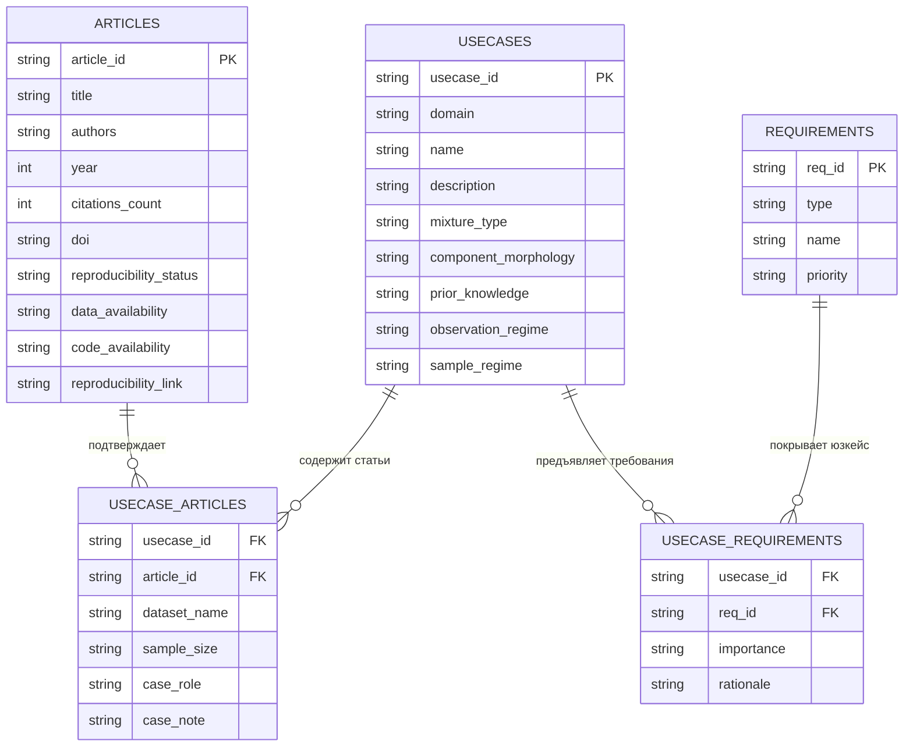

# Методологический план формирования базы прикладных статей и юзкейсов

Настоящий документ фиксирует архитектурный и исследовательский план сбора прикладных публикаций, их систематизации в обобщенные сценарии применения (юзкейсы), оценки воспроизводимости и установления связей с реестром требований библиотеки `pysatl-mpest`.

---

## 1. Концепция и границы предметной области

В соответствии с правилами [`AGENTS.md`](../AGENTS.md), все прикладные статьи и формируемые юзкейсы строго ограничены следующими рамками:

* **Размерность данных**: строго одномерные непрерывные случайные величины ($d = 1$, $X \in \mathbb{R}$).
* **Тип модели**: безусловная функция плотности $f(x)$ конечной смеси ($K < \infty$). Исключены регрессионные модели с ковариатами ($Y \mid X$), временные ряды (HMM) и многоуровневые иерархии.
* **Природа компонент**: непрерывные распределения. Исключены смеси с дискретными массами (Zero-Inflated, Poisson, Binomial).
* **Эмпирическая основа**: статьи обязаны содержать анализ **реальных данных** конкретной предметной области (надежность, биомедицина, климатология, финансы, астрофизика), а не только синтетические симуляции Монте-Карло.

---

## 2. Многомерная таксономия классификации юзкейсов

Вместо привязки к частным именам распределений юзкейсы классифицируются по 5 фундаментальным математическим и методологическим осям:

### Ось 1. Структурная однородность смеси (`mixture_type`)
* **Гомогенная (Homogeneous)**: все $K$ компонент принадлежат одному параметрическому семейству.
* **Гетерогенная (Heterogeneous)**: компоненты представляют разные физические процессы и описываются различными параметрическими семействами (например, фоновый шум + полезный сигнал; штатный износ + внезапный отказ).

### Ось 2. Морфология компонент (`component_morphology`)
* **Симметричные со стандартными хвостами**: экспоненциальное убывание хвостов (гауссовский тип).
* **Тяжелохвостые (Heavy-tailed)**: полиномиальное убывание хвостов, высокий эксцесс, устойчивость к экстремальным значениям ($t$-распределение, Коши, логнормальное).
* **Асимметричные / Скошенные (Skewed / Asymmetric)**: выраженная асимметрия плотности без тяжелых хвостов (скошенные нормальные, распределения экстремальных значений).
* **С ограниченным / полубесконечным носителем (Bounded / Semi-bounded)**: физически строго положительные величины с носителем $[0, +\infty)$ или интервалом $[a, b]$ (Вейбулл, Гамма, Бета), требующие контроля границ носителя.

### Ось 3. Профиль априорной определенности задачи (`prior_knowledge`)
1. **Статус числа компонент ($K$)**:
   * *Фиксированное $K$*: известно заранее из физики эксперимента или биологической природы (например, 2 пола, 3 фазы клеточного цикла).
   * *Неизвестное $K$*: число скрытых субпопуляций подлежит открытию (требует информационных критериев, тестов гипотез или прунинга).
2. **Статус семейств распределений**:
   * *Априори заданные*: известны точные законы распределений компонент.
   * *Конкурирующие / неопределенные*: требуется автоматический скрининг и перебор аналитических форм.
3. **Ограничения на параметры**:
   * *Свободные параметры*: независимая оптимизация всех параметров.
   * *Частично зафиксированные*: фиксация подмножеств параметров (например, калиброванная дисперсия приборного шума).
   * *Связанные параметры*: равенство масштабов компонент (гомоскедастичность) или симметричные веса.
4. **Степень разделенности компонент**:
   * *Выраженные моды*: визуально различимые кластеры (эффективен $k$-means).
   * *Сильное перекрытие / скрытые моды*: унимодальная огибающая с асимметрией или эксцессом (требуются методы моментов, прунинг или мультистарт).

### Ось 4. Наблюдательный режим данных (`observation_regime`)
* **Полные выборки (Full)**: стандартные непрерывные наблюдения.
* **Цензурированные / усеченные (Censored / Truncated)**: наличие интервального, правого или левого цензурирования/усечения.
* **Зашумленные / с изолированными аномалиями (Outliers / Contaminated)**: присутствие грубых выбросов, требующих робастного отсечения или шумовой компоненты.
* **Экстремальный дисбаланс весов (Imbalanced / Rare subpopulations)**: наличие критически важных редких субпопуляций с весом $\pi_k \ll 0.05$.

### Ось 5. Масштаб выборки (`sample_regime`)
* **Малые выборки (Small, $N < 100$)**: риск вырождения масштаба, необходимость регуляризации или MCMC.
* **Умеренные выборки (Moderate, $10^2 \le N \le 10^5$)**: стандартный аналитический режим.
* **Большие выборки (Large, $10^5 \le N \le 10^6$)**: многолетние метеорологические замеры, проточная цитометрия.
* **Сверхбольшие выборки (Massive / Big Data, $N \ge 10^6 \dots 10^7$)**: телекоммуникационный интернет-трафик, звездные каталоги Gaia ($N \approx 3.3 \cdot 10^7$), эксперименты коллайдера LHC ($N \ge 10^6$); критические требования к векторизации и снижению вычислительной сложности.

---

## 3. Критерии воспроизводимости исследований (Reproducibility Audit)

Воспроизводимость фиксируется как **непосредственное свойство научной публикации** и хранится непосредственно в общем каталоге [`articles/raw/articles.csv`](raw/articles.csv) через следующие колонки:

* `reproducibility_status`: агрегированный статус (`full`, `data_only`, `code_only`, `closed`, `not_applicable`);
* `data_availability`: доступность данных (`open`, `in_paper`, `on_request`, `closed`, `not_applicable`);
* `code_availability`: доступность программной реализации (`open_source`, `r_package`, `scripts_in_paper`, `none`, `not_applicable`);
* `reproducibility_link`: прямая рабочая ссылка на репозиторий данных или кода (GitHub, Zenodo, CRAN, UCI, Kaggle).

| Статус (`reproducibility_status`) | Доступность данных (`data_availability`) | Доступность кода (`code_availability`) | Примеры / Источники |
| :--- | :--- | :--- | :--- |
| **`full` (Полная)** | Открытый репозиторий / встроен в R-пакет / Zenodo | Открытый репозиторий GitHub / скрипты в приложении | Датасеты `mclust`, CRAN, GitHub-репозитории статей |
| **`data_only` (Только данные)** | Датасет публичен (UCI, Zenodo, таблица в статье) | Код отсутствует или проприетарный | Классические бенчмарки (Galaxy, Acidity, Enzyme) |
| **`code_only` (Только код)** | Данные закрыты (NDA, конфиденциальные биобанки) | Скрипты/пакет выложены открыто | Клинические исследования с открытым R-пакетом |
| **`closed` (Закрытая)** | Данные коммерческие / конфиденциальные | Код отсутствует | Проприетарные финансовые и медицинские данные |
| **`not_applicable` (Не применимо)** | Теоретические работы, монографии, чистая математика | Код не предполагается | Фундаментальные статьи (Dempster 1977, Meng & Rubin 1993) |

---

## 4. Реляционная схема каталога `articles/raw/usecases/`

---

## 5. Пошаговый план реализации

### Этап 1. Извлечение существующих прикладных статей из `articles.csv`
1. Аудит 431 текущей публикации на наличие реальных данных.
2. Идентификация классических бенчмарков:
   * *Galaxy dataset* ($N=82$, скорости галактик);
   * *Acidity dataset* ($N=155$, кислотность озер);
   * *Enzyme dataset* ($N=245$, активность ферментов);
   * *Hidalgo Stamp dataset* ($N=485$, толщина марок);
   * *Old Faithful geyser* ($N=272$, длительность извержений);
   * *Flow cytometry single-channel* (флуоресценция клеток).
3. Первичная фиксация ссылок на открытые датасеты в R-пакетах (`mixbench`, `mclust`, `datasets`).

### Этап 2. Таргетированный сбор внешних прикладных публикаций (OpenAlex API)
Сбор по 5 целевым доменным кластерам (по 6–10 статей на кластер):
* **Кластер A (Надежность и выживаемость)**: деградация оборудования, время до отказа, смеси Вейбулла/Гамма с цензурированием.
* **Кластер B (Климат и гидрология)**: ветровые бимодальные режимы, экстремальные осадки, смеси с полубесконечным носителем.
* **Кластер C (Биомедицина и цитометрия)**: 1D каналы маркеров клеток, редкие клеточные субпопуляции, асимметричные компоненты.
* **Кластер D (Финансы и риски)**: распределение доходностей, операционные убытки, лептокуртические смеси с тяжелыми хвостами.
* **Кластер E (Астрофизика и физические спектры)**: спектрометрия, космический фоновый шум, смеси с сильным перекрытием мод.

### Этап 3. Экспертный аудит и расширение `articles.csv` атрибутами воспроизводимости
1. Проверка жесткого соответствия скоупу $d = 1$, отсутствия ковариат и непрерывности плотностей.
2. Проверка доступности исходных данных и скриптов (заполнение колонок `reproducibility_status`, `data_availability`, `code_availability`, `reproducibility_link`).
3. Добавление колонок воспроизводимости в существующие строки [`articles/raw/articles.csv`](raw/articles.csv) (для теории `not_applicable`, для эмпирических бенчмарков — ссылки на репозитории).
4. Добавление новых отобранных публикаций в общий каталог [`articles/raw/articles.csv`](raw/articles.csv).

### Этап 4. Формирование каталога юзкейсов (`usecases.csv`)
Синтез 8–12 репрезентативных юзкейсов с заполнением всех осей таксономии.

### Этап 5. Линковка юзкейсов с требованиями (`usecase_requirements.csv`)
1. Определение для каждого юзкейса обязательных (`critical`) и желательных (`desirable`) требований.
2. Формулирование вербального академического обоснования (`rationale`) без математических формул на русском языке per [`AGENTS.md`](../AGENTS.md).
3. Верификация 100% ссылочной целостности реляционной базы.
